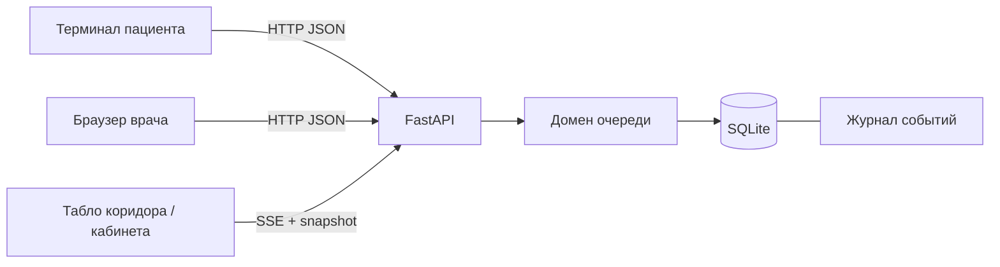
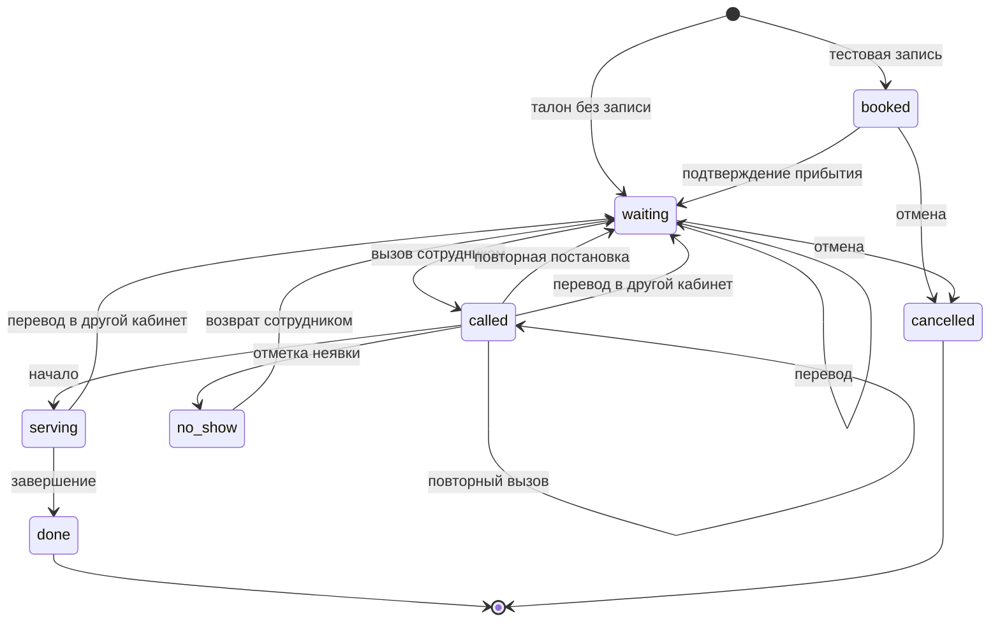
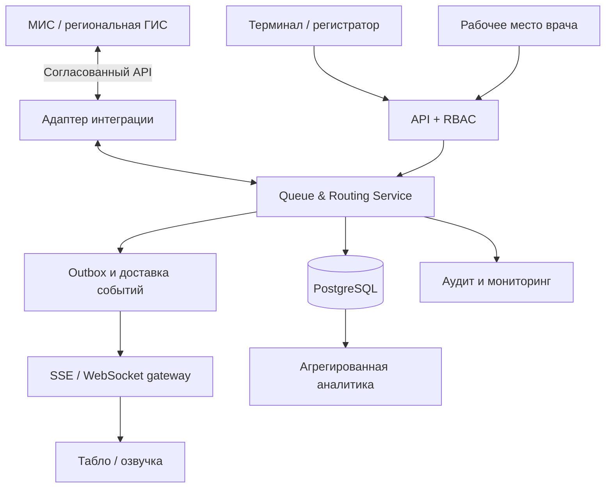

# 2. Архитектура и API

## Демо (реализовано)

Python 3.13 + FastAPI + Uvicorn; HTML/CSS/JS без npm, SQLite с транзакциями BEGIN IMMEDIATE и частичным уникальным индексом: один активный талон на кабинет. SQLite WAL. Все времена на сервере в UTC, отображение браузером в локальном времени. Есть синтетические временные слоты; реальных идентификаторов пациентов нет. Номер талона последовательно генерируется БД; для реального внедрения модель идентификаторов пересмотреть.

## Состояния

Порядок: текущий вызов, доступные талоны с ожиданием от 30 минут по FIFO, наступившие записи по времени слота, остальные FIFO, будущие слоты недоступны. Это предварительная политика демо, не клинический регламент. `call-next` атомарен; неверные переходы дают HTTP 409. Check-in и выдача по уникальному request_key идемпотентны. Для действий и перевода UI передаёт expected_version; защита от всех повторов команд (включая call-next) ещё требует доработки.

## API

| Метод | Путь | Назначение |
|---|---|---|
| GET | `/health` | Проверка сервера и БД |
| GET | `/api/rooms` | Три тестовых кабинета |
| POST | `/api/check-in` | `{"booking_code":"DEMO-101"}` |
| POST | `/api/walk-in` | `{"room_id":"101","request_key":"уникальный ключ"}` |
| GET | `/api/staff/{room_id}` | Активная и ожидающая очередь кабинета |
| POST | `/api/staff/{room_id}/call-next` | Вызов первого ожидающего |
| POST | `/api/staff/{room_id}/tickets/{id}/action` | `{"action":"start"}`; также repeat/finish/no_show/cancel/requeue; expected_version опционален |
| POST | `/api/staff/demo-appointments` | Синтетический импорт записи DEMO-… с датой/часовым поясом |
| POST | `/api/staff/{room_id}/tickets/{id}/transfer` | Перенос в target_room с тем же номером талона |
| GET | `/api/staff/{room_id}/no-shows` | Последние 10 неявок |
| GET | `/api/staff/tickets/{id}/history` | Этапы визита |
| GET | `/api/analytics` | Агрегаты по последним 100 завершённым этапам кабинета |
| GET | `/api/events` | SSE invalidation, heartbeat каждые 10 сек |
| GET | `/api/board` | Только публичная проекция вызова и статуса кабинета |

Swagger `/docs` — актуальная схема реализации. GET-запросы не изменяют состояние. Ошибки 401/403 — ограничение доступа, 404 — неизвестная сущность, 409 — конфликт состояния, 422 — некорректный ввод.

## Данные

`rooms`, `tickets` (номер визита, текущий кабинет, статус, запись/слот, версия, request_key), `events` (события), `queue_legs` (каждый этап: кабинет, прибытие, вызов, начало, окончание, результат). Уникальный индекс обеспечивает один открытый этап на талон. События пишутся в одной транзакции с изменением талона. Журнал пока не защищён от изменения владельцем БД и не содержит учётных записей операторов.

## Целевая архитектура (проект)

Сначала модульный монолит; переход SQLite → PostgreSQL при многопользовательском пилоте, миграции Alembic/SQLAlchemy после фиксации модели данных. Push-события с повторным получением snapshot, а не обязательный брокер с первого дня. Не вводить Redis, Kafka, микросервисы или Kubernetes без измеренной необходимости. Полноценная интеграция, RBAC, мониторинг и расширенная аналитика остаются целью. SSE в v0.2 работает через внутрипроцессный сигнал после коммита, heartbeat и свежий snapshot. Один worker для немедленных обновлений; при нескольких workers события другого процесса видны после heartbeat, для пилота нужен общий транспорт.
