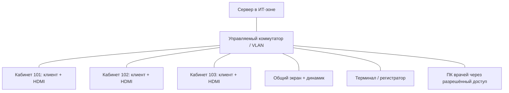

# 3. Оборудование

Рекомендуемый старт: имеющийся ноутбук/ПК и монитор; тест браузера в режиме kiosk. В дальнейшем локальный сервер, один сетевой клиент на экран. Врач использует существующий компьютер. Камеры, микрофоны, GPU и ESP32 не нужны.

| Узел | Предлагаемая конфигурация | Количество для 3 кабинетов | Плановый диапазон, тыс. ₽ |
|---|---|---:|---:|
| Кабинетное табло | 10–15.6″ HDMI, Orange Pi Zero 3 2 GB или Raspberry Pi/мини-ПК, БП, крепёж | 3 | 39–51 |
| Общее табло | 24–32″ IPS + медиаплеер, при большой зоне ожидания 32–43″ после замера | 1 | 15–20 |
| Сервер | Intel N100/аналог, 8–16 GB RAM, SSD 256 GB+, Linux | 1 | 21–30 |
| ИБП | Подбор по реальной нагрузке сервера и сети | 1 | 4–7 |
| Сеть и крепления | Ethernet, коммутация, кабели, корпус, материалы | комплект | 8–20 |
| **Базовый комплект** | | | **87–128** |
| Терминал (опция) | 15.6″ сенсор, мини-ПК, защищённый корпус, QR-сканер | 1 | 38–60 |
| Монтаж (опция) | Настройка, установка, проверка | | 10–40 |
| **Комплект с опциями** | | | **135–228** |

Это расчётные диапазоны из предыдущего обсуждения, не новые проверенные цены и не коммерческие предложения. Без разработки, интеграции, электромонтажа, эксплуатации и возможной закупки принтера. Актуализировать по 2–3 КП и реальному оснащению клиники. На первом тесте терминал можно заменить компьютером регистратора.

## Сеть и размещение

Для реального пилота: Ethernet предпочтительнее Wi-Fi, выделенный сегмент, ACL, TLS и учётные записи устройств. Клиенты табло — Linux и Chromium kiosk, автозапуск systemd, восстановление после питания, heartbeat и автоматическое обновление с откатом. Не хранить реальные данные пациентов на медиаплеерах. Питание 24/7 и теплоотвод проверить на конкретном устройстве. SD-карта — слабое место; выбрать надёжный носитель и минимизировать записи. Сравнить стоимость владения SBC с готовым x86 mini-PC.

## Приёмка оборудования

- 48–72 часа теста без вмешательства, измерить зависания браузера и нагрев.
- Восстановление после отключения электричества и Ethernet; не отображать старый вызов как актуальный.
- Проверить читаемость номера с фактической дистанции, доступность терминала, звук без раскрытия личных данных.
- Согласовать места монтажа, электробезопасность, санитарную обработку, кабельные трассы и ответственность за поддержку.
