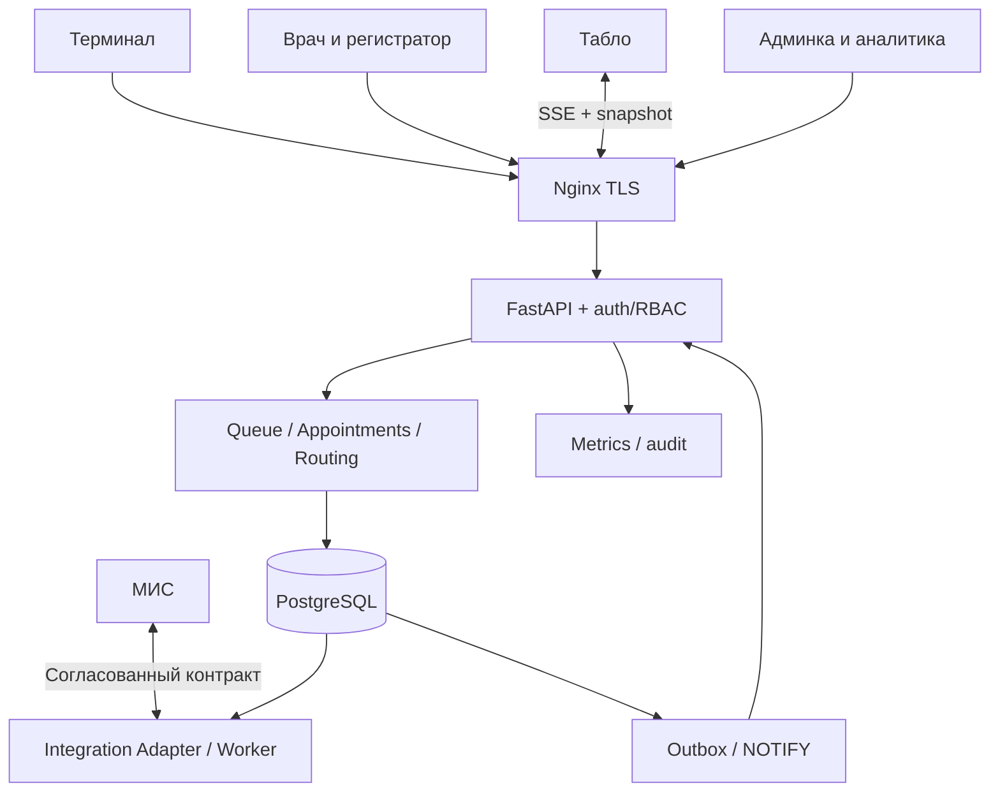

# 12. Технический план разработки Clinic Flow

Статус: предлагаемый план реализации от v0.2 к пилоту. Дополняет [roadmap](06-roadmap.md), [архитектуру](02-architecture.md) и [контракт МИС](04-mis-integration.md). Целевые технологии и показатели ниже — решения для проверки, а не уже реализованные функции или измеренные результаты.

## Цель и границы

Одна поликлиника, один участок, 3 кабинета, один терминал или рабочее место регистратора, общее табло и опциональные кабинетные экраны. Модуль не заменяет МИС, не определяет медицинскую срочность и не блокирует необходимую помощь без записи. Сначала синтетические данные и стенд, затем согласованный теневой/рабочий пилот. До доступа к реальным данным обязательны согласования, ИБ, права доступа, договорённости о резервном процессе.

В v0.2 уже есть FastAPI, SQLite WAL, 4 UI, синтетические записи, история этапов, перевод, ручная неявка и восстановление, SSE, опциональный Basic пароль и 14 тестов. Не переписывать ядро без причины. Отсутствуют реальная интеграция, промышленная IAM, полноценный device management, нагрузочная проверка и подтверждённый браузерный E2E.

## Технологический стек

| Слой | Целевой выбор | Почему / когда |
|---|---|---|
| Backend | Python 3.13, FastAPI, Pydantic, Uvicorn | Сохраняем рабочую кодовую базу и OpenAPI |
| Хранение | PostgreSQL, SQLAlchemy 2, Alembic, psycopg 3 | Пилотная БД, транзакции и явные миграции; SQLite остаётся в legacy demo до завершения перехода |
| Frontend | TypeScript, Vite, HTML/CSS, Fetch/EventSource | Общие типы API и компоненты без тяжёлого фреймворка; мигрируем существующие UI постепенно, React только при реальной необходимости |
| Realtime | SSE + snapshot + PostgreSQL LISTEN/NOTIFY | Односторонние обновления экранов; уведомление только сигнал, состояние читается из БД |
| Фоновые задачи | Worker + PostgreSQL transactional outbox | Доставка интеграционных событий, повторные попытки, сверка; без отдельного брокера до измеренной необходимости |
| IAM | OIDC, существующий SSO учреждения или Keycloak, RBAC | Не писать собственный протокол аутентификации. Сессии HttpOnly/Secure/SameSite, CSRF для мутаций, отзыв сессии, scoped tokens для устройств |
| MIS | REST / FHIR / другие согласованные интерфейсы, HTTPX | Адаптеры не зависят от очереди; FHIR только при наличии у вендора. Тестовый адаптер не выдавать за API Витакора |
| Голос | Локальные WAV-фразы и цифры; Piper TTS опционально | Офлайн и контролируемая озвучка. Проверить права на голос/модель и разборчивость; Web Speech API — текущий демо-вариант |
| Аналитика | SQL, Python, Chart.js | Сначала измеряем и показываем статистику; ML после данных и baseline |
| Deploy | Nginx, TLS, Docker Compose, Debian/Ubuntu Server | Один локальный сервер, предсказуемая установка; секреты не в Git |
| Устройства | Linux, Chromium kiosk, systemd, HDMI, Ethernet | Автозапуск, heartbeat, восстановление после питания, идентификация экрана |
| Observability | Структурированные логи, Prometheus, Grafana | Health/readiness, p95, lag, device online, ошибки, очередь outbox; без ПД и секретов в логах |
| QA | pytest, HTTPX, Playwright, Locust, Ruff, mypy, ESLint | Домен, API, БД, E2E, нагрузка и статический анализ |
| CI | GitHub Actions, pinned dependency lock, SCA/SBOM (например pip-audit/Trivy) | Блокировать merge при провале обязательных проверок; артефакты только с синтетическими данными |

Выбор конкретных версий новых пакетов после совместимости и проверки уязвимостей. Не добавлять Kafka, Redis, Kubernetes, GPU и ML в обязательный MVP.

## Архитектура

Модульный монолит + отдельный worker; один репозиторий. API обслуживает терминал, регистратора, врача, админ-панель, табло и аналитику. МИС остаётся источником истины для записей и медвизитов, очередь — для своих событий. Владение статусами согласовать.



Состояния, ограничения и базовые команды — см. [02](02-architecture.md). REST для команд и запросов, SSE только для invalidation; после reconnect всегда fresh snapshot, heartbeat и stale-screen timeout. Для нескольких процессов NOTIFY будит подписчиков, но не является гарантированной доставкой: периодическая сверка revision/snapshot. Outbox хранит долговечные сообщения интеграции, а не персональные данные для публичных табло.

## Модель данных (целевая)

| Таблица | Ответственность |
|---|---|
| facilities, departments, rooms | Учреждение, подразделение, кабинет, расписание работы |
| appointments | Непрозрачный внешний ID, источник, версия, слот, статус записи |
| visits, tickets | Один визит, локальный публичный номер талона, жизненный цикл |
| queue_legs | Этап маршрута: кабинет, прибытие, вызов, начало, завершение, исход |
| route_templates, route_steps | Допустимые маршруты и зависимости этапов, версия шаблона |
| users, role_assignments | Связь с субъектом IdP, роли в границах учреждения/кабинета |
| devices | Тип, привязка, статус, версия, время последнего heartbeat |
| queue_events, audit_events | История переходов и действий оператора, причина и correlation ID |
| outbox, inbox | Повторяемая доставка, уникальный event ID, попытки, конфликт/сбой |
| idempotency_keys | Повтор команды возвращает исходный результат; конфликт тела отклоняется |

Время UTC, часовой пояс учреждения для отображения. Технические IDs UUID (или другой согласованный устойчивый ключ), публичный номер талона ограничен областью и периодом, не является идентификатором личности. Уникальность активного вызова на кабинет, одного открытого этапа на визит, ключа внешней записи в контуре источника. Индексы по учреждению, комнате, статусу, времени слота. Конкурентный вызов сериализовать транзакционной блокировкой строки кабинета; перевод блокирует оба кабинета в стабильном порядке. Проверка версии и idempotency всех критических команд. Журнал в одной транзакции с доменным действием; отдельные права записи/чтения аудита. Политика хранения и обезличивания после согласования.

## План спринтов и релизов

Оценка инженерной работы для двух разработчиков при существенной занятости: 6–8 недель до технически готового пилотного кандидата на синтетических данных. Это не договорный срок, не прогноз длительности согласования. Доступ к МИС, клиника, безопасность и монтаж — внешний критический путь. Этапы ниже частично идут параллельно.

| Релиз / этап | Срок-ориентир | Результат и критерий перехода |
|---|---|---|
| Discovery (CF-02/03) | Неделя 1 и далее | Проверены 2 клинических процесса, штатные функции МИС, владелец проблемы, API/sandbox и метрики; если проблема решается штатно — пересмотреть продукт |
| v0.3 Core | Недели 1–2 | Слоистый backend, PostgreSQL/Alembic, настраиваемые кабинеты/слоты, транзакции, idempotency, миграция и регрессия |
| v0.4 Secure & Admin | Недели 3–4 | OIDC/RBAC, сессии, защищённые API устройств, аудит, админка, TLS, тесты изоляции и отказов |
| v0.5 Integration | Недели 3–5 (параллельно) | Mock MIS + contract tests, outbox/inbox, сверка, обработка отмены/переноса, реальный адаптер только после доступа |
| v0.6 Devices & UX | Недели 5–6 | 3 кабинетных экрана/общее табло, терминал, offline TTS, heartbeat, QR (при наличии безопасного кода), проверка доступности и браузерный E2E |
| v0.7 Pilot candidate | Недели 7–8 | Маршруты нескольких кабинетов, метрики, нагрузка, наблюдаемость, проверка backup/restore, документация установки и отката; согласованный ручной процесс |
| v1.0 Clinical pilot | После согласований | Реальная МИС в разрешённом контуре, подготовка сотрудников, baseline и ограниченный пилот, отчёт и решение go/no-go |
| v1.x | После пилота | Тиражирование, прогноз ожидания после накопления репрезентативных данных, опции оборудования |

### Спринт 1: первые технические задачи

| ID | Приоритет | Задача | Критерий приёмки |
|---|---|---|---|
| DEV-01 | P0 | Зафиксировать API v0.2 и тесты | CI зелёный; все старые 14 сценариев сохраняются; браузерный smoke проходит в нормальной среде |
| DEV-02 | P0 | Выделить domain/services/repositories/api | Логика не зависит от HTTP и SQLite; unit-тесты домена |
| DEV-03 | P0 | PostgreSQL в Compose, SQLAlchemy, Alembic | Чистая установка и миграция, схема на тестовой БД, никаких секретов по умолчанию в пилотном профиле |
| DEV-04 | P0 | Facilities/rooms/slots, seed demo | Кабинеты создаются через конфиг/сервис, scope в запросах, только синтетический seed |
| DEV-05 | P0 | Конкуренция и idempotency | Параллельные вызовы не создают два активных талона; повтор запроса не вызывает другого пациента; stale version = 409 |
| DEV-06 | P0 | Перенос тестовых SQLite-данных и backup | Номера, статусы, этапы, временные отметки и связи сверены; rollback описан; legacy база не уничтожается |
| DEV-07 | P1 | Событийный transport | Два процесса и несколько SSE клиентов получают изменение; reconnect/heartbeat читают правильный snapshot |
| DEV-08 | P1 | CI integration suite | PostgreSQL service, миграции, API, линтер, typecheck; ошибки блокируют merge |

### Спринт 2: безопасность и администрирование

- Пилотный профиль fail closed, отдельный явный demo mode, секреты через окружение/secret store.
- Роли: системный администратор, администратор учреждения, регистратор, врач с разрешёнными кабинетами, аналитик (агрегаты), устройство-киоск и устройство-табло (минимальные права).
- Проверки прав на каждый объект и учреждение; отзыв токенов устройств; аудит actor/действия/объекта/времени/причины; запрет утечек между кабинетами/учреждениями.
- Админ-панель: кабинеты, рабочие часы, привязка экранов, сотрудники/роли, правила очереди и статусы устройств. Изменения правил только после согласования клиникой.
- TLS, сессии, CSRF, rate limits, контроль публичных проекций, синтетический нагрузочный стенд.

### Спринт 3: адаптер МИС и маршруты

- Определить интерфейс AppointmentAdapter, сначала MockMisAdapter. Сценарии: импорт слота, изменение времени/кабинета, отмена, дубликат, событие вне порядка, outage, восстановление, ручной конфликт.
- Передавать минимум полей. Inbox с уникальным event_id/version, транзакционный outbox, backoff, dead-letter/ручная сверка. Никаких запросов к реальной МИС без разрешения.
- Пилотный адаптер только по официальной спецификации и с sandbox. Не обещать Vitacore/FHIR, пока не подтверждены.
- Маршрут как граф зависимостей разрешённых процедур; подсказка свободного следующего кабинета только в разрешённой группе, ручное подтверждение и история. Медицинские ограничения и срочность определяет персонал.

### Спринт 4: оборудование, UX и приёмка

- Поставить Linux + Chromium kiosk на Orange Pi / Raspberry Pi или mini-PC, systemd restart, фиксированный URL и привязка к кабинету, watchdog, heartbeat, recovery.
- Тестовый терминал с большим шрифтом, доступным контрастом, подтверждением действий и вариантом регистрации у сотрудника. QR — непрозрачный ограниченный код, не ФИО и не полис; без смартфона тоже доступно.
- Табло показывает только вызванный номер и кабинет, озвучка локальная; отключение сети скрывает устаревшие вызовы. Не запускать повторную озвучку автоматически после reconnect без согласованного правила.
- Панель аналитики: p50/p90 ожидания, длительность, отклонение от слота, неявки, простои, длительность полного маршрута, количество ручных вызовов; denominators и пропуски данных фиксировать.
- Репетиция сбоя, backup/restore, тест трёх кабинетов и реального SBC. Нагрузочный тест с 50 экранами, 20 рабочими местами и 5 терминалами как предварительный профиль (уточнить по реальному участку).

## Целевая структура репозитория

```text
clinic-flow/
  app/
    domain/           # сущности, переходы, правила и ошибки
    services/         # use cases: call, check-in, transfer, routing
    repositories/     # интерфейсы и PostgreSQL-реализация
    api/              # routers, schemas, dependencies
    integrations/     # base, mock, vendor adapter после согласования
    realtime/         # SSE, revision, уведомления
    auth/             # OIDC, RBAC, device credentials
    analytics/        # агрегаты, экспорт
    devices/          # inventory, pairing, heartbeat
    workers/          # outbox, reconciliation
    main.py
  frontend/
    src/
      shared/         # API client, types, accessibility, SSE
      kiosk/
      staff/
      board/
      admin/
      analytics/
  migrations/
  tests/
    unit/
    integration/
    contract/
    e2e/
    load/
  deploy/
    nginx/
    kiosk/
    monitoring/
  docs/
  scripts/
  compose.yaml
  .github/workflows/
```

Это будущая структура; текущие файлы не удалять заранее. Переносить модули по одному с тестами. Для внешнего контракта предусмотреть /api/v1, оставить текущий API до переноса UI и проверок обратной совместимости.

## Definition of done и критерии технической приёмки

- Все обязательные CI проверки зелёные; миграции проходят на чистой и предыдущей тестовой схеме; браузерный E2E и интеграционные тесты на PostgreSQL выполнены.
- Ноль двойных активных вызовов на кабинет и повторных выдач при тестах конкурентных команд; нет доступа к чужому учреждению и запрещённому кабинету.
- Предварительные инженерные цели для локальной сети под согласованной нагрузкой: p95 REST до 200 мс, p95 вызов → отрисовка на табло до 1 секунды, stale-warning не позднее 15 секунд после потери подтверждённого соединения. Это цели, не результаты. Измерять реальный браузер, не только backend.
- 48–72 часа работы на выбранном устройстве, автоматический запуск после питания, корректный offline и восстановление. Согласованные RPO/RTO, фактическое контрольное восстановление, оповещение о сбоях.
- Ручная обработка исключений и безопасный fallback проверены с персоналом. Нет автоматической медицинской сортировки/ранней отмены.
- Официально согласованы интеграция, безопасность, правовые основания обработки, доступы и ответственность. Реальный пилот запрещён до выполнения условий.

## Работа команды

Предложение при двух разработчиках: разработчик A — backend, БД, интеграция и CI; разработчик B — UI, устройства, E2E и стенд; оба review критических переходов и безопасности. Представитель продукта/медицины ведёт интервью, согласует процесс, метрики, сценарии и пилот. Назначение конкретных людей и часы не согласованы. Issue = небольшая проверяемая задача; ветка feature/*, PR, минимум один review, обязательные тесты, squash merge по принятому процессу.

**Первое решение go/no-go:** если штатная очередь МИС уже устраняет проблему при включении/настройке, предпочтительнее интеграционный сервис/поставка оборудования. Если остаётся измеримая проблема и доступ к МИС подтверждён — продолжать собственный продукт. Не ждать интеграцию, чтобы улучшить синтетический стенд, но не строить предположительный vendor API.
