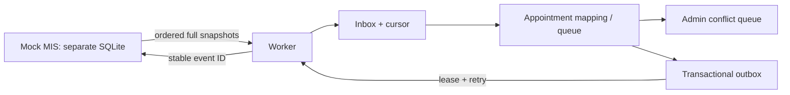

# v0.5 — MIS Integration (synthetic contract candidate)

## Scope and ownership

This is a vendor-neutral INTERNAL contract, not the Vitacore API or a claim of FHIR compatibility. The provider controls appointment snapshots (external ID, version, room, UTC slot, booked/cancelled); Clinic Flow controls local queue status and history. No names, diagnoses, policy numbers or other real patient data. One installation = one clinic. Codes must begin MIS- and are synthetic only. Doctor rosters and working calendars are not imported; this increment synchronizes appointment slots by room.

### Architecture



AppointmentEvent = event_id + AppointmentSnapshot(external_id, version, booking_code, room_id, scheduled_at with timezone, state). Source and external ID together form a stable mapping. FeedItem.position is a contiguous positive integer in this mock contract. Provider adapter exposes pull(after, limit) and deliver(event). A real adapter will have to map its native cursor or change log, stable IDs, versions, schedule and accepted operations to this contract; do not assume these properties without verification.

## Incoming events

Each transaction writes the incoming event fingerprint/outcome, mapping, queue mutation (if permitted), audit and cursor together. Duplicate event ID + same payload is safe; reusing the ID with a different payload is rejected (worker stops at that position, no silent skip). Older versions are recorded as stale; same version with different payload produces a version_collision conflict. Subsequent strictly newer full snapshots can resolve a conflict when safe. Full snapshots mean intermediate versions need not arrive in order, but feed positions must be contiguous. No auto-delete for an appointment absent from a snapshot. Use explicit cancellation; full feed replay is safe with stable IDs. Provider feed retention, cursor reset and full snapshot reconciliation after feed gaps are future work.

| Existing local state | Incoming change | Result |
|---|---|---|
| No ticket | booked / cancelled | Create booking if room/code valid; cancellation records mapping without ticket |
| Booked, untouched | Move slot/room or cancel | Apply atomically, keep number |
| Arrived / called / serving / done / no-show | Changed appointment or cancellation | Conflict; preserve local state, no automatic interruption |
| Any | Unknown room, colliding/changed booking code | Conflict (when relevant); never overwrite another booking |
| Cancelled | New booked state | Conflict; no silent reopening |

A booked ticket with open conflict cannot check in; contact registrar. Existing active care continues. Admin can apply after correcting a resolvable issue or keep local with a required reason. Applying cannot bypass safeguards for active/terminal visits; manual operational resolution is required. Version collision requires a new unambiguous revision or explicit keep-local. Resolution verifies observed version and conflict kind to avoid stale decisions. Keeping local records the decision; it does not change the provider schedule or assert reconciliation with a real vendor.

## Outgoing events

The queue event and corresponding outbox event commit together for a linked ticket's local check-in, call/repeat, start/finish, no-show, cancel, requeue or transfer. Provider-originated changes never echo back. Payload has stable UUID event_id, sequence, external_id, latest OBSERVED appointment_version (may be conflicted), action, local queue_status, room_id, occurred_at. It is not a request to edit the vendor schedule.

At-least-once delivery: lease with random ownership token, no network I/O in DB transaction, 5 attempts, exponential retry (2–32 seconds in current default), dead-letter after final failure/expired final lease. Later events for the same appointment wait until predecessors are delivered; other appointments can progress. Worker crash after provider commit may send the same ID again; simulator deduplicates by ID and payload. Actual vendor must supply compatible idempotency or reconciliation; exactly-once is NOT guaranteed. Leases and stale acknowledgements are checked; a slow in-flight request can still deliver late, so external sink must deduplicate. A dead-letter is manually retried with same ID. No automated silent discard.

## Demo

Start on an existing local SQLite demo (with dependencies installed and server at localhost:8000), using the same CLINIC_DB_PATH for the app and worker:

```bash
python -m scripts.mock_mis publish --external-id appointment-1 --version 1 --booking-code MIS-DEMO-0001 --room 101 --scheduled-at 2026-01-01T10:00:00+00:00
python -m scripts.mock_mis worker --once
```

Use a past synthetic timestamp so the slot is eligible. Open kiosk and confirm MIS-DEMO-0001. Call/start through staff UI, then simulate cancellation (same external ID and code, higher version):

```bash
python -m scripts.mock_mis publish --external-id appointment-1 --version 2 --booking-code MIS-DEMO-0001 --room 101 --scheduled-at 2026-01-01T10:00:00+00:00 --state cancelled
python -m scripts.mock_mis worker --once
python -m scripts.mock_mis received
```

The already-active visit remains in place. Check GET /api/integration/status and /api/integration/conflicts (local demo Swagger or secure admin /admin); in secure mode only admin can resolve/retry. Complete the visit locally; next worker cycle delivers its event. Use a fresh demo DB and mock feed together if repeating the scenario from scratch (never delete real data). Separate provider file must not be the same as the queue database. Worker --once returns nonzero on observed provider failure; continuous worker logs counters, not raw payloads.

For PostgreSQL local Compose:

```bash
docker compose -f compose.postgres.yaml --profile mock-mis up --build -d
docker compose -f compose.postgres.yaml --profile mock-mis exec mock-mis python -m scripts.mock_mis publish --external-id appointment-1 --version 1 --booking-code MIS-DEMO-0001 --room 101 --scheduled-at 2026-01-01T10:00:00+00:00
docker compose -f compose.postgres.yaml --profile mock-mis exec mock-mis python -m scripts.mock_mis received
```

Worker polls every 2 seconds, external simulator file uses separate named volume. Do not mount real MIS DB. An independent worker process currently relies on screen heartbeat/snapshot (up to ~10s), not immediate in-process SSE. Mock profile is NOT included in secure compose; an approved real worker needs separate configuration, credentials, service identity and network permissions.

## APIs, migration and verification

- GET /api/integration/status — counts, cursors, outbox states and limited dead letters.
- GET /api/integration/conflicts — latest desired snapshot without booking code, conflict kind, local ticket ID.
- POST /api/integration/resolve — source, external_id, version, expected_conflict, decision (apply/keep_local), reason.
- POST /api/integration/retry — event_id UUID; only dead-letter.
- Admin-only in secure mode. In demo these routes use existing optional staff Basic authentication and are local only. No public webhook or arbitrary provider URL.
- PostgreSQL Alembic 0003_integration, SQLite schema v5; additive. Back up before upgrading. Old SQLite v2/v3 importer is still restricted to those versions; no automatic import of v4/v5 security or integration tables.
- CI includes contract validation, mapping, rescheduling, cancellation, stale versions, ID collisions, rollback/cursor atomicity, conflict resolution, parallel claims, lease recovery, duplicate delivery, dead-letter recovery, provider outage and API role access. Both DBs; inspect actual GitHub Actions for the run result.

## Remaining gates

Obtain authorized API/sandbox and official technical contact, align ownership and slot/room mapping, actual schedule/doctor resources, identifiers, delivery guarantees and safe retry policy. Confirm cancellation, check-in, appointment status updates and event order with vendor. Add provider auth/TLS, timeout/backoff policy, durable provider health/alerts, operational reconciliation after feed gaps, full snapshot and retention rules, bounded queue growth, integration E2E and load test. Validate conflict decisions with clinic; add operator notification. Secure UI browser tests and Compose deployment still require verification. No real patient processing or production compliance claim.
