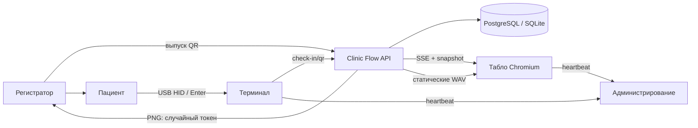

# v0.6 — Devices & UX

Демонстрационный программно-аппаратный контур Clinic Flow. Все сценарии используют синтетические данные. Изменения не означают готовность к промышленной эксплуатации в клинике.

## Что добавлено

- QR-регистрация через USB HID-сканер (клавиатурный ввод, суффикс Enter) или ручной тестовый ввод. Камера, мобильное приложение и Интернет не требуются.
- Выдача QR-кода записи из рабочего места регистратора/администратора, PNG и временный тестовый текст; большие сенсорные кнопки и экран подтверждения номера талона.
- Табло с контрастными карточками, отдельным фильтром кабинета, явными состояниями вызова/приёма/ожидания, индикатором отсутствия актуальных данных.
- Локальная озвучка на основе фиксированных русских WAV-фраз и цифр, сгенерированных eSpeak NG во время сборки. Никаких облачных API и Web Speech fallback. Сборка Docker генерирует клипы автоматически.
- Телеметрия авторизованных устройств и панель администратора: состояние интерфейса, возраст последнего успешного чтения, готовность звука, версия клиента, online/offline.
- Пакет Chromium Kiosk: отдельный профиль браузера, пользовательский systemd-сервис, контроль процесса, проверка /health и повторный запуск после восстановления связи. TLS проверяется системным/браузерным хранилищем сертификатов.
- Миграция Alembic 0004_devices и SQLite schema v6: qr_credentials и device_telemetry.

## Схема

## QR и права

POST /api/staff/qr: booking_code, ответ qr_text, png_base64, expires_at (Unix seconds).
POST /api/check-in/qr: code (CF1: + 43 символа base64url), request_key (16–100 разрешённых символов).

Токен — 256 бит случайности, без ФИО, внешнего ID, номера полиса или назначения; хранится только SHA-256 хеш. TTL — 24 часа (предварительный параметр стенда). На одну запись один действующий код, новый выпуск отзывает предыдущий. Выпуск возможен для booked без открытого MIS-конфликта. Подтверждение и потребление токена, доменные события, аудит и MIS outbox фиксируются одной транзакцией. Повтор с тем же токеном, actor и request_key возвращает исходное подтверждение до срока действия; другой actor/ключ не может погасить его повторно. Смена состояния записи, истечение срока, повторный выпуск и конфликт МИС блокируют соответствующее подтверждение.

Secure-профиль: выпуск QR только admin/registrar, погашение только admin/registrar/kiosk. Board и doctor не получают права на выпуск или check-in. Демо-режим сохраняет старую опциональную Basic-авторизацию для персонала; не выставлять в сеть. Код — секрет предъявителя; не помещать в URL, журналы, публичные файлы, принт-логи. Синтетический ручной booking_code остаётся доступен для совместимости. Это не полноценная идентификация пациента и не замена утверждённой политике регистрации реальных записей. Проверить срок, выдачу и доставку кода с МИС и клиникой до пилота.

### Демо

1. Открыть /staff и раздел «Выдать QR-код записи», ввести DEMO-101.
2. Открыть /kiosk?device=1, USB-сканер должен вводить QR в поле «Код записи» и отправлять Enter. Без сканера можно вставить тестовый CF1:… и нажать Enter.
3. Терминал показывает номер, очищает ввод, предлагает «Готово» и автоматически убирает результат через 45 секунд.
4. Вызвать пациента на /staff, проверить /board?room=101&device=1.
5. Повторное погашение с новым request_key или использование старого QR после перевыпуска отклоняется.

## Локальная озвучка и связь

На сервере: установить espeak-ng, затем python -m scripts.build_audio. WAV-файлы — генерируемые артефакты, не хранятся в Git. В Docker сборка встроена. Браузер загружает и декодирует только собственные локальные аудиоресурсы и воспроизводит цифры/короткие фразы из буфера. Кабинеты с числовым кодом озвучиваются цифрами; для буквенно-цифровых используется «пройдите в указанный кабинет» и визуальная информация. Не озвучиваются имена и медицинские сведения.

Кнопка «Включить озвучку» нужна для браузерной активации. На выделенном киоске CF_AUTOPLAY=1 включает попытку автозапуска; политика браузера/аудиосистемы может потребовать ручного действия. При отключении, смене вызова, устаревании или потере связи прекращается озвучка и скрываются номера. После восстановления первый снимок не озвучивается повторно, сотрудник может повторить вызов. Это снижает риск устаревшего вызова; не гарантирует доставку каждого голосового сообщения (например, при очень коротких состояниях/сетевых сбоях). Использовать визуальное табло как основной канал.

Snapshot возраст проверяется таймером, порог 15 секунд, таймер 1 секунда; ошибка чтения или событие offline скрывает данные раньше. Это не жёсткий SLA при заморозке браузера/OS. При недоступном сервере терминал блокирует новые операции, сохранённые ключи в памяти позволяют повторить неопределённый запрос без повторной регистрации. Перезапуск браузера теряет эти ключи; при неоднозначном результате обратиться к регистратору. Табло при возврате связи получает актуальный снимок, а не старый вызов из кэша.

## Телеметрия

POST /api/devices/heartbeat: page (board/kiosk/unknown), state (ready/stale/starting/unknown), age_seconds (0–86400 или null), audio_ready, client_version. Неподдерживаемые поля и неверный тип интерфейса отклоняются. Legacy {} поддержан. Сервер записывает только последнюю телеметрию, timestamp со своей стороны. Устройство не может выбирать чужой ID. Online означает недавний heartbeat (75 секунд), а не факт того, что физический монитор/динамик работает; display_state=unknown при просрочке. Это самоотчёт браузера, не аппаратная аттестация и не проверка реального звука. В secure-админке обновить сведения вручную. Мониторинг истории/алертов, аппаратные метрики и автоматическая проверка рендерера в backlog.

## Установка устройств и ограничения

[deploy/kiosk/README.md](../deploy/kiosk/README.md) — инструкция для Debian/Armbian/Raspberry Pi OS и обычных x86 Linux-киосков. Проверки физического дисплея, USB-сканера, ALSA/PipeWire, ARM64-образа, автологина, DPI, температуры, работы 24/7, отключения питания и зависания renderer выполняются на реальном устройстве. Системный supervisor восстанавливает завершившийся процесс и перезапускает Chromium при подтверждённом возврате связи; не умеет надёжно обнаружить зависший renderer, а при отсутствии сервера на старте ожидает доступность. Не отключать sandbox или TLS-проверки.

## Проверки

CI содержит регрессию SQLite/PostgreSQL, конкурентную проверку QR, срок, перевыпуск, защиту от повторов, атомарность отката, роли и телеметрию. Генерирует WAV локально, проверяет синтаксис JS и shell, запускает обычный браузерный smoke и отдельный сценарий QR, декодирования/воспроизведения WAV и offline/reconnect. Посмотреть фактический результат соответствующего коммита в GitHub Actions; физический сканер и слышимость на реальном динамике не заменяются браузерным тестом.

Следующий этап: v0.7 — разрешённые маршруты из нескольких этапов, оценка ожидания, расширенная аналитика, нагрузка, backup/restore и протокол приёмки пилотного стенда. Реальная МИС, IdP/HTTPS на площадке и эксплуатационная ИБ-приёмка остаются внешними требованиями.
