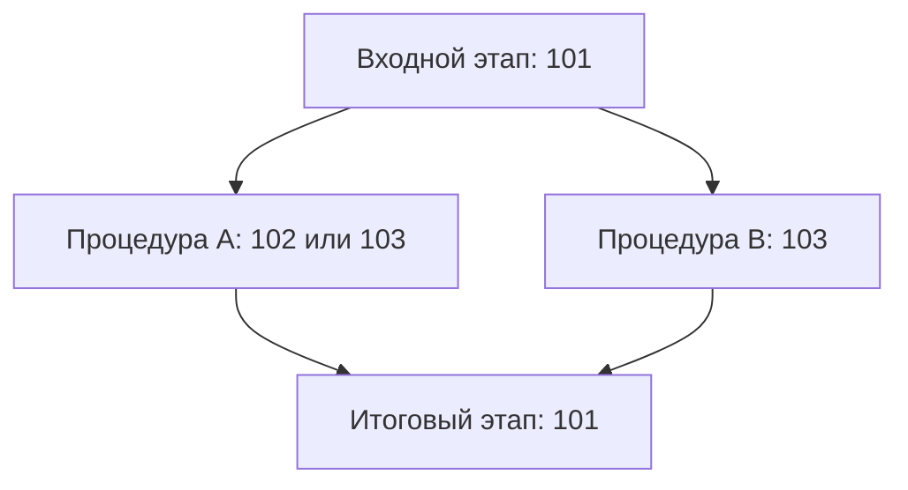

# v0.7 — Routing, Analytics & Pilot Candidate

## Статус и границы

Демонстрационный кандидат на синтетических данных. Это не готовая промышленная медицинская система и не разрешение на реальный пилот. Доступ к МИС «Витакор», соответствие регламентам, ИБ, реальные устройства и внешние согласования остаются отдельными условиями. Одна установка = одна клиника. Операционные роли из v0.4 сохраняются.

## Маршрутизация

Администратор публикует неизменяемые версии шаблона. Шаблон — ограниченный DAG (до 20 обязательных этапов), где каждый этап содержит ID, название, разрешённые кабинеты-альтернативы и зависимости. Запрещены циклы, неизвестные зависимости/кабинеты, дубли. При публикации требуется ожидаемая текущая версия; старые визиты сохраняют свою версию, новые назначаются на актуальную. Регистратор/администратор назначает шаблон ожидающему талону в разрешённом начальном кабинете.



A и B разрешено проходить в разном порядке, но итоговый этап доступен лишь после обоих. На практике зависимости и альтернативность утверждает медицинский персонал, а не модель. Код не принимает клинических решений. Каждая процедура выполняется ровно один раз в плане; неявка/повторная постановка оставляют текущий этап незавершённым. Отмена ожидающего талона отменяет маршрут и отражается в аудите; обычный перевод и преждевременное завершение активного маршрута запрещены. Нет автоматического перемещения пациента или медицинского триажа.

Переход выполняется одним вызовом API после явного подтверждения сотрудником, который уже начал текущий этап. В одной транзакции закрывается этап с outcome=done, отмечается выполненный step ID, открывается новый queue_leg, сохраняется номер талона и новый кабинет, пишутся событие и аудит. Внешний outbox получает событие transfer (не final finish) для связанной МИС; окончательное завершение — finish. Повтор с тем же Idempotency-Key возвращает исходный ответ. expected_version обязателен для назначения и перехода. Врач может выбрать лишь кабинет, доступный ему по RBAC; если такого варианта нет, переход оформляет регистратор/администратор по подтверждённому факту. В интерфейсе есть редактор JSON синтетического шаблона, назначение маршрута и окно выбора следующего этапа.

| Метод | Путь | Роли secure |
|---|---|---|
| GET | /api/routes/templates | admin/registrar |
| POST | /api/routes/templates | admin |
| POST | /api/staff/{room}/tickets/{id}/route/attach | admin/registrar |
| GET | /api/staff/{room}/tickets/{id}/route | admin/registrar/scoped doctor |
| POST | /api/staff/{room}/tickets/{id}/route/advance | admin/registrar/scoped doctor (оба кабинета) |
| GET | /api/pilot/analytics?hours=24 | admin/analyst |

Финальный этап закрывается обычной командой finish. Встроенный шаблон в UI является синтетическим примером, не медицинским протоколом. БД: Alembic 0005_pilot, SQLite schema v7; добавлены route_templates и visit_routes. Миграция аддитивная; для отката использовать проверенный backup. Не использовать импорт v2/v3 как способ переноса v7.

## ETA и выбор кабинета

Для каждого доступного кабинета считаем количество ожидающих, которых уже можно вызвать, и активный приём. При наличии минимум 5 положительных длительностей последних 100 полностью завершённых этапов берём медиану обслуживания. ETA нового не приоритетного пациента ≈ число допустимых ожидающих × медиана + оценка оставшейся длительности активного этапа. Для уже начавшегося этапа вычитается прошедшее время с нижней границей 0; вызванному этапу назначается полная медиана. Не учитываются будущие записи, новые приходы, график/перерывы, неоднородность процедур, время перехода и клинический приоритет. Никаких обещаний точного времени.

Если все разрешённые варианты имеют ETA, сортируем по нему; иначе для всех сравниваем текущую нагрузку (ожидающие + активный), не предпочитаем кабинет просто из-за наличия данных. При равенстве — детерминированное сравнение ID этапа и кабинета. Рекомендация не меняет очередь до подтверждения. Для реального внедрения откалибровать на репрезентативных данных, оценить MAE, p90 ошибки и покрытие; ML лишь после baseline.

## Аналитика и симуляция

Отчёт за 1–168 часов: завершённые этапы, неявки, p50/p90 ожидания и длительности, наблюдаемое время обслуживания, интервалы между зарегистрированными завершёнными приёмами, ETA и размер выборки. Метрики по максимум 10 000 последним закрытым этапам на кабинет за окно, с признаком усечения. Неявки и переводы не считаются завершённым лечением; статистика обслуживания использует done-этапы с началом. Межприёмный интервал не является фактическим простоем врача, observed_service_seconds не является загрузкой в процентах без календаря доступности. Маршрут: длительность от назначения шаблона до полного завершения, p50/p90, количество активных и отменённых; не равно полному времени визита от входа в поликлинику.

```bash
python -m scripts.simulate_flow --patients 100 --interarrival 120 --service 300 --seed 42
```

SimPy создаёт виртуальные ресурсы вместимости 1 для кабинетов. Одинаковые заранее сгенерированные времена прихода и длительности этапов используются для fixed-order и workload-aware. Принимаются только разрешённые этапы; прогноз не использует будущее фактическое время обслуживания. Параметры, seed, p50/p90 по этапам и визитам, пропускная способность (число завершённых этапов) и makespan выводятся в JSON. Можно передать собственный синтетический JSON через --plan. Нет календарей, персонала, приоритета, записей или времени перемещения; результаты иллюстрируют поведение двух политик на заданном сценарии и не доказывают эффект в клинике.

## Мониторинг

/metrics — Prometheus exposition: HTTP responses by bounded family/method/status, latency до заголовков ответа (SSE не время жизни соединения), DB reachability, агрегаты ticket/route/outbox, conflicts, online devices. Нет талонов, пациентов, subject, raw paths и credentials в labels. Один registry на процесс, один Uvicorn worker по умолчанию. При сбое БД clinic_db_up=0; при остановке процесса срабатывает Prometheus up. Метрики не являются аудитом.

Для локального PostgreSQL demo выставить секреты CLINIC_POSTGRES_PASSWORD и CLINIC_GRAFANA_PASSWORD в защищённом окружении и запустить:

```bash
docker compose -f compose.postgres.yaml -f compose.monitoring.yaml up --build -d
```

Prometheus: 127.0.0.1:9090; Grafana: 127.0.0.1:3000 (admin + установленный пароль). Provisioned datasource/dashboard и три alert rules. Алерты видны в Prometheus, внешние уведомления/Alertmanager не настроены. Overlay — только demo; версии образов зафиксированы предварительно, перед пилотом проверить обновления и уязвимости. В secure /metrics выключен без CLINIC_METRICS_TOKEN, при включении требует Bearer; Nginx запрещает внешний путь /metrics. Не использовать demo overlay для secure без отдельного закрытого scrape-контура и секретов. Compose Prometheus/Grafana ещё требует запуска на целевой площадке.

## Backup и восстановление

Использовать исключительно синтетический контур. Скрипт не перезаписывает существующий файл. SQLite backup API создаёт согласованный снимок и проверяет integrity/foreign keys:

```bash
python -m scripts.demo_backup --confirm-demo sqlite-backup data/clinic.sqlite3 backups/demo.sqlite3
python -m scripts.demo_backup --confirm-demo sqlite-restore backups/demo.sqlite3 data/restored.sqlite3
```

Для PostgreSQL установите совместимые pg_dump, pg_restore и psql (17 для PostgreSQL 17), задайте libpq окружение/защищённый .pgpass. Никогда не передавайте пароль в командной строке/репозиторий. Создайте НОВУЮ пустую БД через согласованный административный процесс. Не подключайте к ней приложение до восстановления.

```bash
python -m scripts.demo_backup --confirm-demo pg-backup clinic backups/demo.dump
python -m scripts.demo_backup --confirm-demo pg-restore backups/demo.dump clinic_restore
```

pg_restore использует single-transaction, exit-on-error, no-owner/no-acl и отклоняет непустую цель. Не восстанавливать недоверенные dump-файлы (они могут содержать SQL). Скрипт не восстанавливает роли PostgreSQL, права, конфигурацию IdP, ключи TLS, внешнюю МИС или отдельный файл mock-провайдера; согласованный cutover, credentials/session revocation, device re-pairing, шифрование/retention, внешние резервные копии и RPO/RTO остаются задачами эксплуатации. Проверить работу на изолированной копии и не переотправлять старые события в реальный внешний контур. Файлы backup хранятся вне Git, с ограниченными правами; восстановление на реальных данных запрещено текущим scope.

## Нагрузочная проверка

```bash
python -m scripts.load_smoke --postgres --screens 50 --staff 20 --kiosks 5 --seconds 8
```

Для уменьшения нагрузки при одновременных обновлениях общий публичный snapshot табло читается один раз на поколение событий с коротким TTL 0,5 с; фильтрация по правам выполняется после получения снимка на каждом запросе. SSE объединяет всплески событий в окно 75 мс, не передавая данные пациента. Снимок инвалидируется после локального коммита, изменения другого процесса ограничены штатным heartbeat/polling (до 10 с + время чтения); это не распределённый cache. При ошибке чтения не отдаём старый снимок.

Тест создаёт временную схему в TEST_POSTGRES_URL (только отдельная тестовая БД), один сервер на loopback, 50 SSE-клиентов со snapshot после события, 20 читателей рабочего места, 5 выдающих талоны терминалов и 3 оператора на трёх кабинетах. По умолчанию без --postgres — временная SQLite. Вывод: количество запросов по группе, клиентский p50/p95/p99, количество выдач/вызовов/завершений, ошибки. 8 секунд — smoke, не стабильная производительность; не сравнивать с production SLA. Проверить длительные тесты, 48–72 часа работы, физические устройства, end-to-end от клика до рендера под нагрузкой, RPO/RTO и failover. На площадке пересмотреть polling/SSE, пул БД и сериализацию транзакций по результатам измерений.

## Release gate

CI включает оба хранилища, конкурентные команды и маршрутные ограничения, OIDC RBAC, QR/устройства, SimPy, browser smoke, SQLite backup и реальный PostgreSQL dump/restore. Смотрите фактические результаты соответствующего SHA. [Протокол приёмки](18-pilot-acceptance.md) не считать автоматически выполненным. Не запускать реальный пилот до подтверждённой интеграции, ИБ-приёмки, медицинского регламента и физического стенда.
